# netzilla

A single-window, retro-CRT-styled terminal app that pulls together the free
network, DNS, TLS, routing, threat-intel and hardware-lifecycle lookups a
network admin actually reaches for — plus the local tools (`dig`, `whois`,
`openssl`, `ping`, `traceroute`, `mtr`) that no API should be replacing.

Twenty-one tabs, seventeen dark colour themes, **free and open data sources
only**, and zero setup to start using most of it. Runs on **Linux, macOS and
Windows**. **Version 4.6.0.**

- **Pixel graphs in kitty and Ghostty.** Live Wi-Fi signal, a channel
  spectrum, interface rates and the speed test are drawn as real
  anti-aliased images in terminals that can show them, and as text
  everywhere else — netzilla asks the terminal what it is and decides for
  itself.
- **Nothing paid.** Every source is free; most need no key at all.
- **Every control checked.** Every button on every tab and every documented
  key, in both cases, is exercised by the test suite.

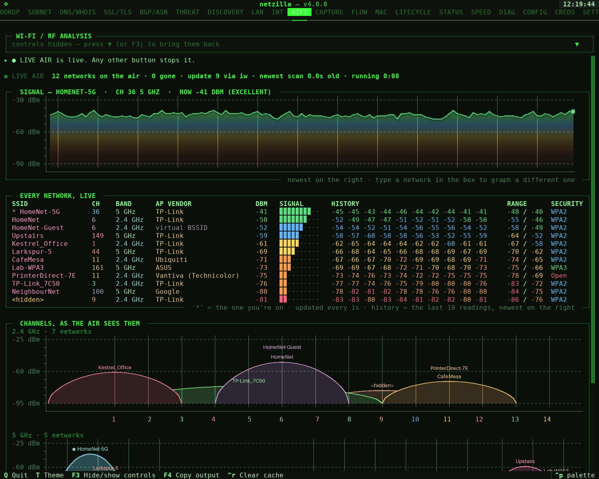

## What's new in 4.6

netzilla runs on Windows and macOS too: one codebase, the same tabs, buttons
and keys on all three systems.

| | |
|---|---|
| **Windows** | Interfaces, LIVE RATES and FLOW's connections (with the program behind each) from Windows' own IP Helper API; the WIFI tab from its Native Wi-Fi API — every access point with exact dBm, live signal graphs, channels and link health; BLUETOOTH through Windows' Bluetooth stack. No administrator rights needed. `tracert` and `pathping` stand in for `traceroute` and `mtr`; with no `dig` or `whois`, DNS records come over DNS-over-HTTPS and WHOIS from netzilla's own client (IANA → registry → registrar). Capture uses Wireshark with Npcap. |
| **macOS** | The WIFI tab (`system_profiler`, or `airport` on 14.3 and older), LIVE RATES, DASH's NETWORK PULSE, WIFI → TRAFFIC and FLOW (`netstat -ib`, `netstat`, `lsof`) now work on macOS. iftop and capture need no sudo once Wireshark's ChmodBPF is installed; `mtr` runs through the sudo session AUTHENTICATE opens. DASH shows real uptime and memory. |
| **Everywhere** | A missing tool names the command that installs it on your system (`apt`, `brew` or `winget`), or says what netzilla does instead where the tool doesn't exist. Every tab's TOOL CHECK and the instruction cards read right for the system you're on. |

### What works where

Every lookup over the internet works the same on all three. The local tools
differ:

| | macOS | Windows |
|---|---|---|
| **DNS/WHOIS** | Everything, with the `dig` and `whois` macOS ships | ALL RECORDS and REVERSE over DNS-over-HTTPS (no `dig`), so the DNS-server box is ignored; no DIG +TRACE; built-in WHOIS client |
| **SSL/TLS** | LibreSSL's full handshake report | Python's own TLS handshake unless you install OpenSSL |
| **LAN** | ROGUE DHCP needs sudo; SNMP tools built in | No ROGUE DHCP (Windows' DHCP Client holds UDP/68); no SNMP POLL (no current Net-SNMP for Windows) |
| **INT** | LIVE RATES built in; iftop/vnstat/bmon from Homebrew | LIVE RATES; no iftop/vnstat/bmon |
| **WIFI** | No BSSIDs or AP makers on 14.4+; a scan takes a few seconds; no retries or missed beacons | Everything but retries and missed beacons; Windows 11 24H2+ needs location access allowed |
| **CAPTURE** | Wireshark with ChmodBPF, or a sudo session | Wireshark with Npcap; no tcpdump |
| **FLOW** | Process names for your own programs without sudo | Everything |
| **DIAG** | `mtr` needs root (AUTHENTICATE or sudo) | `tracert` and `pathping` |
| **Pixel graphs** | kitty and Ghostty | Text graphs (Windows Terminal) |

## What's new in 4.5

DASH's pictures come alive:

| | |
|---|---|
| **Right** | Tokyo at night, now a picture: Tokyo Tower, the Skytree, the towers by the bay and the Rainbow Bridge under the stars — recoloured from the theme, like the beast. |
| **Left** | The beast's breath is alive. It rolls through the theme's own bright colours (primary, accent, success, warning, error) in waves that leave the jaws and run out to the title, its brightness rippling as they go — a 2.4-second loop. kitty and Ghostty swap a small image per frame (each sent once); Tilix and other terminals recolour the sextants. It rests whenever DASH's banner is out of sight. |


## What's new in 4.4

DASH's title gets a picture on each side, in the active theme's colours:

| | |
|---|---|
| **Left** | A horned beast — armoured back lit from within, a spiked tail curled over it, claws like scythes — breathing a storm of energy into the title. It's a picture that ships with netzilla, recoloured from the theme: the body in its main colour, the hottest parts (eyes, back, breath) burning towards white with a touch of its accent. |
| **Right** | Tokyo at night: Tokyo Tower, the Skytree, office towers with their windows lit, Mt. Fuji with snow on its peak, a crescent moon. |
| **Everywhere** | Part of the banner image in kitty and Ghostty, with the same glow and scanlines as the letters; sextant characters in Tilix and other terminals, the beast shaded two colours to a cell. The pictures grow with the window up to 46 columns each; narrower windows get the title alone. DASH still fits 160 × 50. |

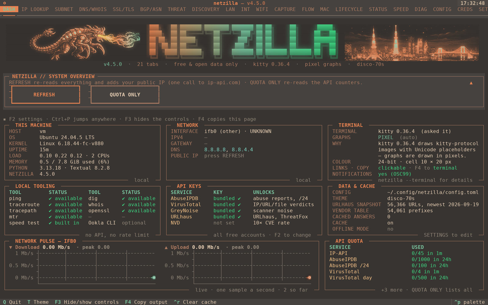

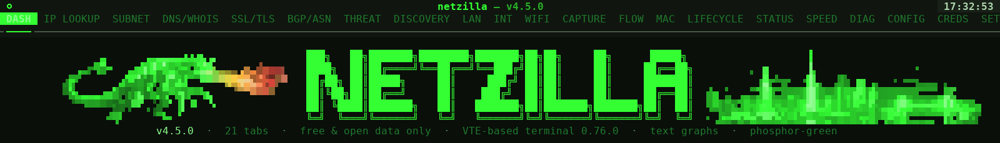

## What's new in 4.3

Pick one device or network in a live list — and show only it.

| | |
|---|---|
| **Pick one** (WIFI: BLUETOOTH, BT TRACKERS, LIVE AIR) | Click a row and the big signal graph follows it; the row is marked ▶ and a line over the list says what is picked, with **SHOW ONLY IT** and **LET GO** buttons. From the keyboard: <kbd>Tab</kbd> to the list, <kbd>↑</kbd> <kbd>↓</kbd> to pick. |
| **Show only it** | Click the picked row again (or <kbd>Enter</kbd>) and the whole view shows only that device or network: its row, a taller graph, and everything known about it — for a Bluetooth device what its broadcasts say (name, best guess, maker, whether its address is fixed or changes for privacy, manufacturer data, services, transmit power) and its signal (lowest / average / highest, rough distance and what that assumes, broadcasts a second, how long it has been near you, the tracker check); for a Wi-Fi network its vendor, channel, security and signal over the run, the spectrum with just that network, and who shares or overlaps its channel. <kbd>↑</kbd> <kbd>↓</kbd> step to the next one, still on its own; <kbd>Esc</kbd> steps back. |
| **Follows you around** | A device picked in BLUETOOTH stays picked in BT TRACKERS (if it's a tracker); SIGNAL watches the network picked in LIVE AIR when the GRAPH box is empty. Typing in the GRAPH box drops the pick — whichever you did last wins. |
| **Steadier lists** | Rows change places only when a signal has really moved, and hold still while the pointer is over the list, so a row can't move away as you click. |
| **Fixed** | BLUETOOTH could graph a device last heard a minute ago as "nearest". It now graphs the nearest heard in the last 15 seconds, and greys a quiet device's old reading. |

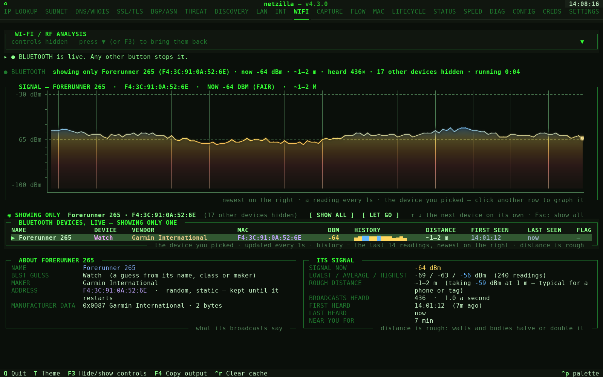

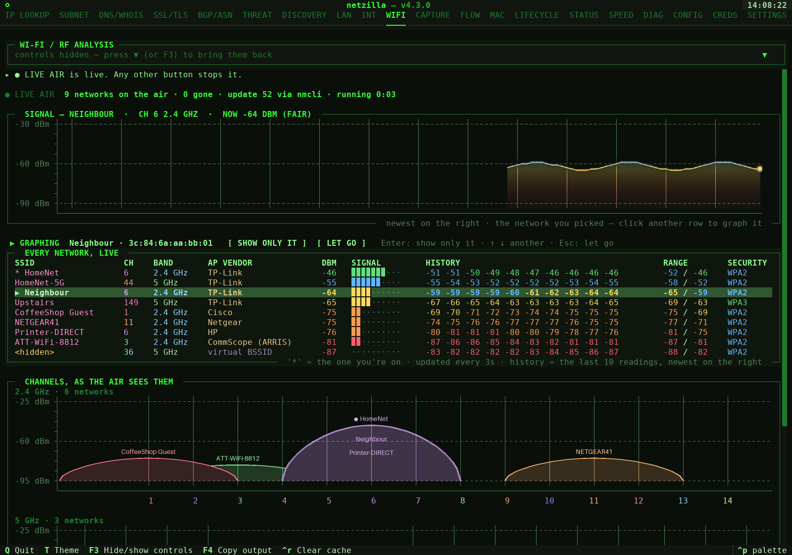

## What's new in 4.2

| | |
|---|---|
| **BLUETOOTH** (WIFI tab) | Every Bluetooth device broadcasting nearby, live: its name, maker (from the manufacturer ID in the broadcast), a best guess at what it is — phone, earbuds, watch, TV, beacon, tracker… (AirPods models, AirTags and Find My, Windows PCs, iBeacon/Eddystone, Fast Pair, Tile, SmartTag, Chipolo and Find Hub tags are decoded) — signal with a history sparkline and a big graph, rough distance, and first and last heard. Listening only: it never pairs or connects. |
| **BT TRACKERS** | The tracker safety check: trackers near you for 10+ minutes, or heard on two or more networks you were on (remembered locally for seven days), are flagged. An AirTag with its owner never is. |
| **Buttons lined up** | Every tab's buttons sit on equal columns shared by all its rows, full rows run edge to edge, and drop-downs are as tall as the boxes beside them. |

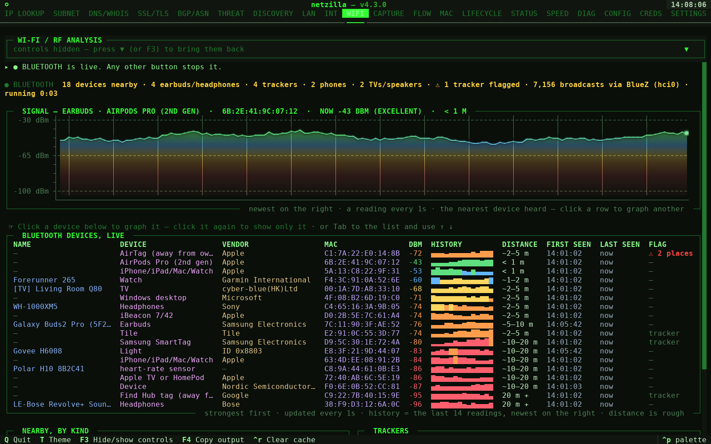

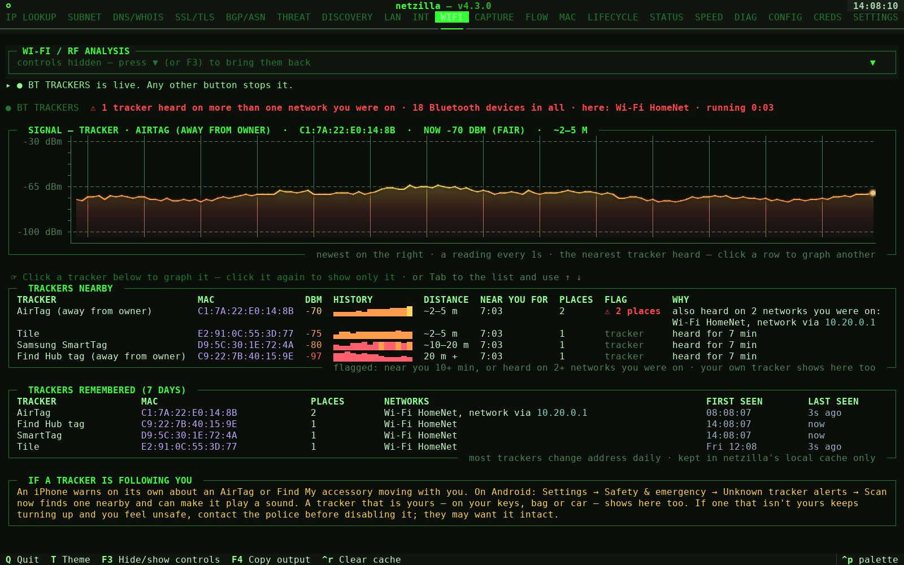

## What's new in 4.1

DASH and SETTINGS now use the whole screen.

| | |
|---|---|
| **DASH** | Centred logo, then three rows of panels side by side: THIS MACHINE (OS, kernel, uptime, load, memory), NETWORK (interface, addresses, gateway, real DNS servers, Wi-Fi link, public IP and ISP), TERMINAL, LOCAL TOOLING, API KEYS, DATA & CACHE, a live **NETWORK PULSE** graph of the default interface and the API QUOTA counters. Three columns on a wide terminal, two or one on narrower ones; at 160 × 50 nothing needs scrolling. |
| **SETTINGS** | Buttons at the top; API keys on the left, appearance, display and behaviour on the right, with one-row boxes; a new KEYS AND STORAGE panel (key sources, config and cache files, exports folder, terminal). Stacks into one column below ~118 columns. |


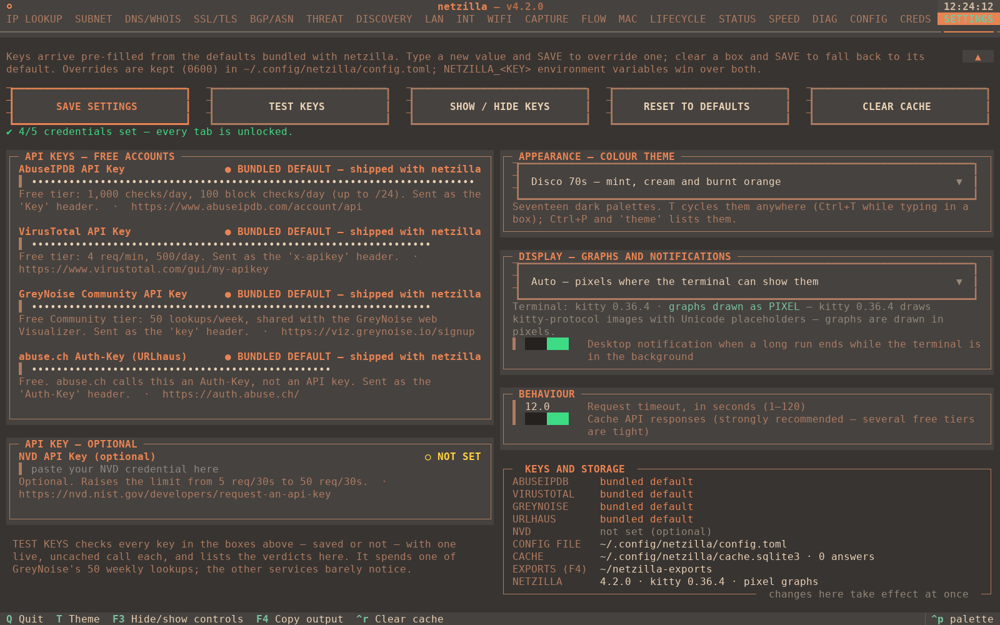

## What's new in 4.0

| | |
|---|---|
| **Pixel graphs** | kitty 0.28+ and Ghostty 1.0+ get image graphs on WIFI (LIVE AIR, CHANNELS, SIGNAL, LINK HEALTH, TRAFFIC), INT, FLOW, CAPTURE and SPEED, plus a lit-tube DASH banner. Other terminals keep text graphs, now with a braille-dot spectrum. |
| **Terminal detection** | Asks the terminal its name and version (XTVERSION), image support and cell size at start-up; knows kitty, Ghostty, WezTerm, iTerm2, Konsole, VTE, Windows Terminal, Alacritty, foot, tmux, Zellij, screen and SSH. `netzilla --terminal` shows what it found and why. |
| **Free sources only** | Shodan's paid API, and the OutageDeck and EOSL.ai key boxes, are gone. DISCOVERY runs on the free InternetDB. |
| **New** | DISCOVERY → **HOST PROFILE** and **CVE DETAIL** (CVSS + FIRST EPSS + CISA KEV); THREAT → EPSS column; LIFECYCLE → **SOFTWARE EOL** (endoflife.date); SPEED → a **built-in speed test** with bufferbloat grade; DNS without `dig` (DNS-over-HTTPS). |
| **Faster** | Tabs are built on first visit: on screen in under half 3.5's time. |
| **Conveniences** | <kbd>F4</kbd> copies a tab's results, <kbd>Ctrl</kbd>+<kbd>P</kbd> command palette, <kbd>Enter</kbd> runs the box's own action, clickable links, desktop notifications for long runs. |
| **Fixed** | <kbd>Q</kbd>/<kbd>T</kbd> now work in both cases; `--tab`, `--theme` and commands match in any case; and a dozen smaller bugs found by pressing every control. |

## What's in it

| Tab | What it does |
|---|---|
| **DASH** | Public IP, local tools, the terminal and how graphs are drawn, key sources, API quota |
| **IP LOOKUP** | One address, five independent reputation/geo opinions in parallel |
| **SUBNET** | IPv4/IPv6 CIDR maths, splitting, host fitting, range → CIDR |
| **DNS/WHOIS** | `dig`/`whois`, RDAP, DoH resolver-disagreement check, typosquat scan; DNS-over-HTTPS when `dig` is missing |
| **SSL/TLS** | Local cert check, SSL Labs grade, crt.sh Certificate Transparency search |
| **BGP/ASN** | Prefix origin, AS overview, peers, RPKI, origin history (hijack alerts) |
| **THREAT** | CVE with CVSS, EPSS and KEV; URLhaus, ThreatFox/MalwareBazaar/Feodo, first-seen timeline |
| **DISCOVERY** | What the internet sees on an address: InternetDB scan, HOST PROFILE from four free sources, CVE DETAIL ranked by KEV, EPSS and CVSS |
| **LAN** | Sweep that names every device on the network (vendor, hostname, what it is), per-device IDENTIFY, rogue-DHCP detector, duplicate-IP watch, SNMP, syslog catcher |
| **INT** | Per-interface live throughput graphs, iftop/vnstat/bmon reports, NIC maker |
| **WIFI** | A Wi-Fi workbench: live signal graphs for every network, a channel spectrum, live link health, devices on this Wi-Fi and their ports, live traffic and packets on the wireless interface, 1/6/11 channel pick, CSV export — plus BLUETOOTH (everything broadcasting nearby) and BT TRACKERS (a tracker that keeps showing up near you) |
| **CAPTURE** | Live or bounded tshark/tcpdump capture, protocol stats, pcap save/read |
| **FLOW** | This host's own connections — top talkers with ASN/geo/reverse DNS (LAN peers identified), service breakdown, bandwidth, blacklist flagging |
| **MAC** | Offline IEEE vendor lookup (~54,000 prefixes), private-MAC detection, "is it on my LAN right now?" |
| **LIFECYCLE** | Hardware end-of-sale / end-of-life dates, and software release support (OS, firmware, runtimes) |
| **STATUS** | Live status for 180 cloud/SaaS vendors — "is it us or them" |
| **SPEED** | Built-in speed test: download, upload, latency, jitter, bufferbloat — drawn live |
| **DIAG** | ping, traceroute+ASN, mtr, port list, path MTU, NTP drift |
| **CONFIG** | Paste in a `show interfaces`/running-config and get it summarized, fully local |
| **CREDS** | Pwned-password (k-anonymity) and breach-directory lookup |
| **SETTINGS** | Every API key, theme, graphics mode, notifications, cache controls |

Most of it needs no API key and no root.

## Pixels where the terminal can draw them, text everywhere else

netzilla asks the terminal what it is before the interface starts (about a
third of a second) and draws graphs in whichever form will work:

| kitty / Ghostty | any other terminal |
|---|---|
| 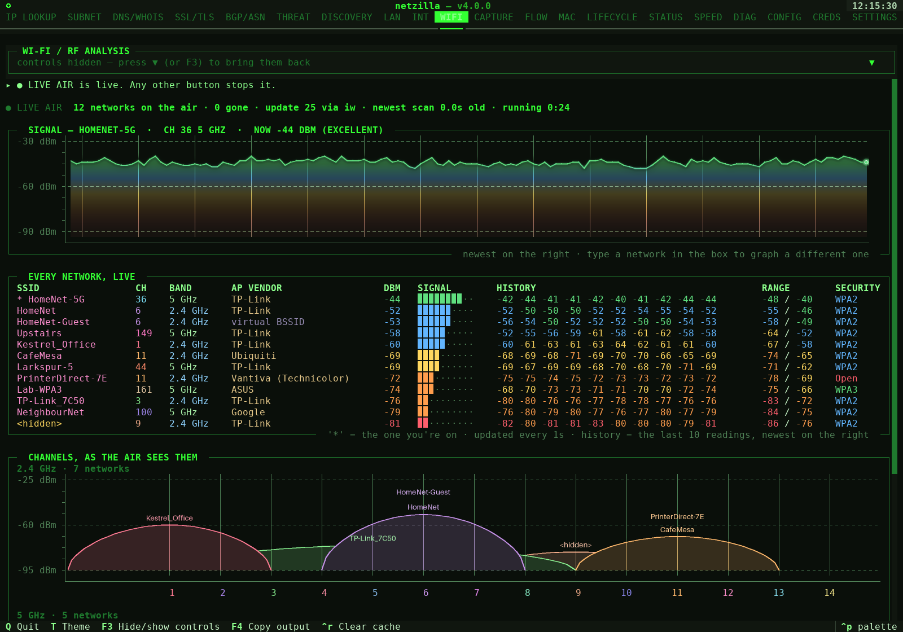 | 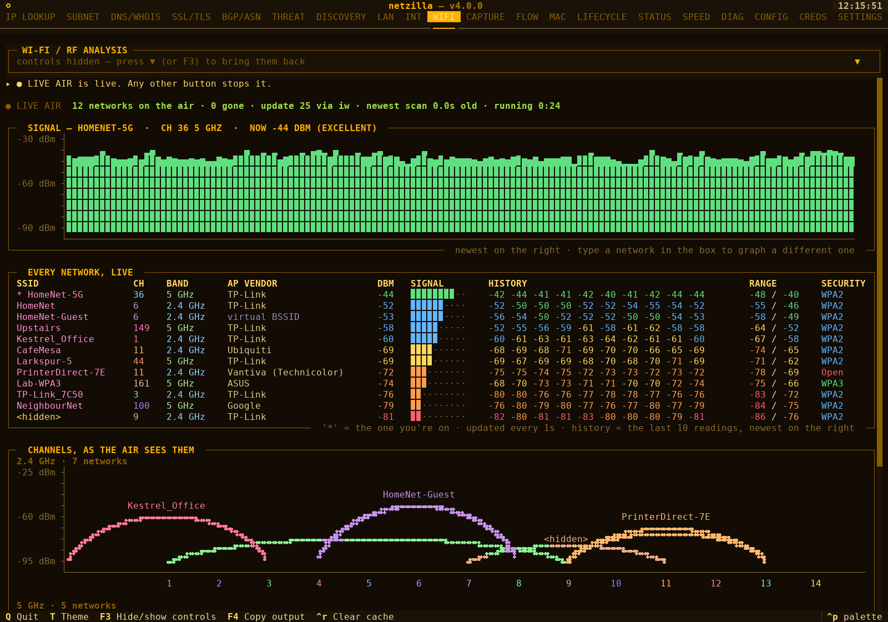 |
| 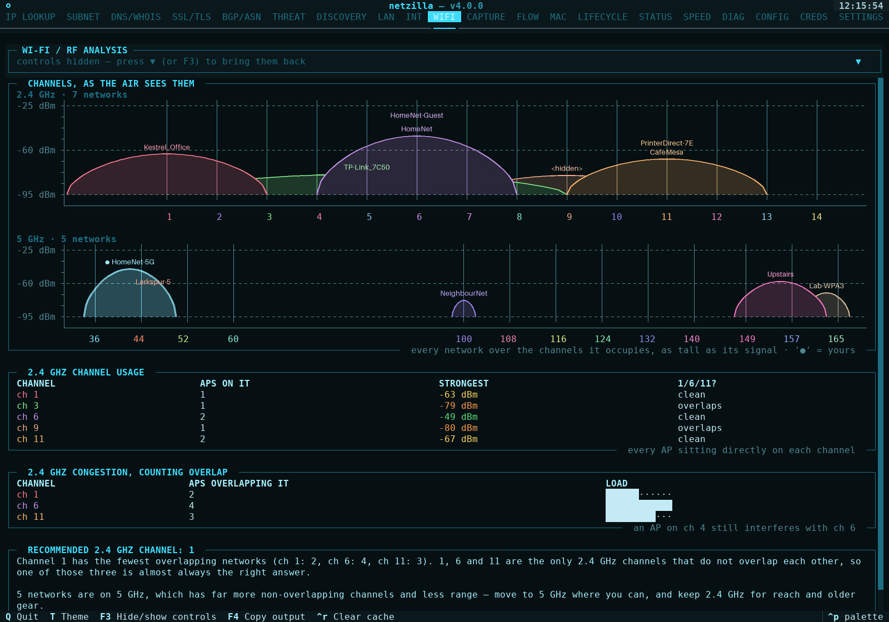 | 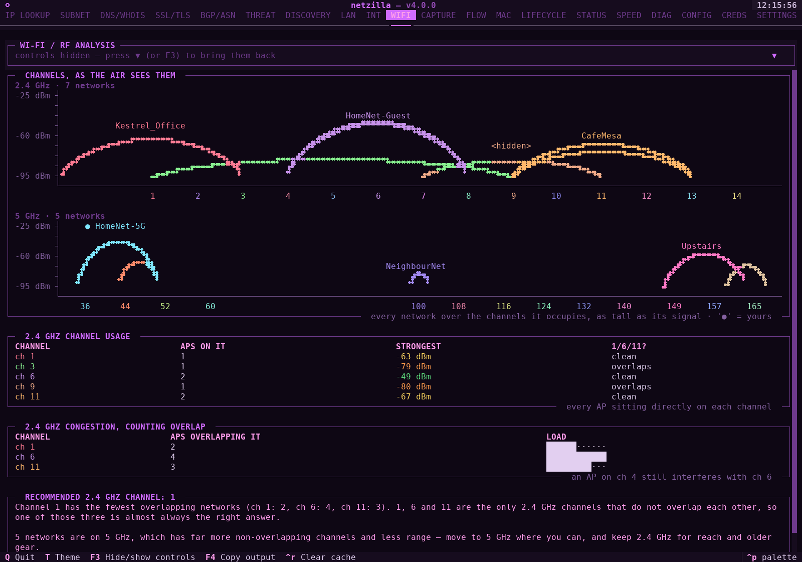 |

The image sits exactly where the text graph would: labels, axes and channel
numbers stay as text, so nothing moves when you switch. Pixels are used only
where they are known to work — kitty 0.28+, Ghostty 1.0+, or any terminal
that answers the kitty feature query with Unicode-placeholder support — and
inside tmux when `allow-passthrough` and 24-bit colour are on (netzilla asks
tmux which terminal you're attached from). WezTerm, Konsole, iTerm2, GNOME
Terminal and the rest get text graphs.

```console
$ netzilla --terminal
Terminal                 Ghostty 1.2.3
Identified by            XTVERSION reply (asked the terminal)
Truecolour               yes
kitty graphics           yes
Unicode placeholders     yes
Cell size                10 x 21 px
Hyperlinks               yes
Clipboard (OSC 52)       yes
Notifications            osc777
Graphics setting         auto
Graphs will be drawn as  pixel
Why                      Ghostty 1.2.3 draws kitty-protocol images with Unicode placeholders — graphs are drawn in pixels.
```

Choose **Auto** (default), **Pixel** or **Text** on SETTINGS → DISPLAY, or
for one run with `netzilla --graphics text`.

## The WIFI tab — everything for a Wi-Fi problem, live

Press a button once; the live views keep updating in place until you press
another one (or for as many seconds as **STOP AFTER** says).

| Button | What you get |
|---|---|
| **LIVE AIR** | Updates every 3 seconds (or whatever REFRESH EVERY says — 1 s works): every network with a live signal bar and its last ten readings in dBm, a big graph of your own network — or of the one you click — a live spectrum of the channels, networks that disappear marked *gone*, and the 2.4 GHz 1/6/11 load as it changes. Click a network twice to show only it |
| **SIGNAL** | One network's dBm as a full-height live graph — walk the building and watch it (the one in the GRAPH box, or the one picked in LIVE AIR) |
| **LINK HEALTH** | Your own connection, live: signal and bitrate graphs, retransmissions *per second*, missed beacons, roaming, addresses/gateway/DNS, and a plain-English verdict |
| **DEVICES** | Who else is on this Wi-Fi — the LAN sweep and device identification, aimed at the Wi-Fi's own subnet |
| **PORTS** | The identifying-port check across every device found, with a "worth a second look" list (Telnet on a smart plug, RDP left on…) |
| **TRAFFIC** | Download/upload of the wireless interface graphed second by second, and which apps are talking to whom over it |
| **PACKETS** | A live capture on the wireless interface: packets/sec, protocols, busiest hosts named by the DNS lookups seen, the lookups themselves |
| **CHANNELS** | Every network as a hump across the channels it really occupies (20/40/80/160 MHz, from the driver), and the channel to pick |
| **BLUETOOTH** | Every Bluetooth device broadcasting nearby: name, maker, best guess at what it is, signal history, rough distance, first and last heard — trackers flagged. Click a device to graph it, twice to show only it with everything its broadcasts say |
| **BT TRACKERS** | Trackers near you for 10+ minutes, or heard on two networks you were on, flagged — with what to do about one that isn't yours |
| **EXPORT CSV** | All of the above, saved as CSV |
| **SCAN / DEEP SCAN** | The one-shot survey, and exact dBm via `iw` |

LIVE AIR never waits for the radio: each update reads the latest finished scan
(instant), your own network is read from the driver every update, and new
scans run in the background. A full scan of every channel takes most adapters
2–4 seconds, so other networks' readings are as fresh as that — the headline
says how old the newest one is.

| | |
|---|---|
| 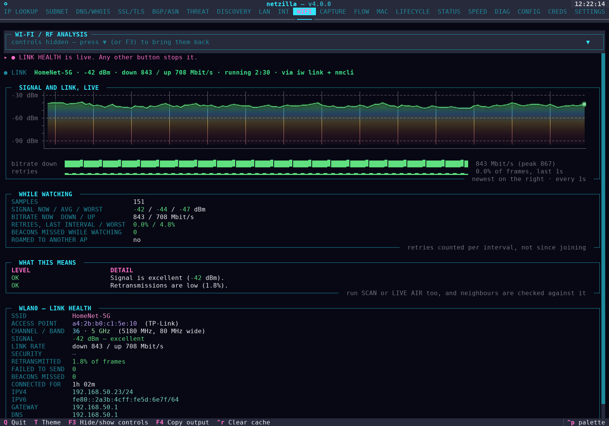 | 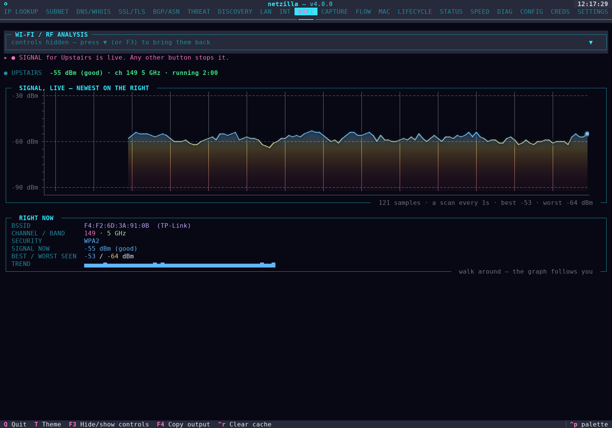 |
| 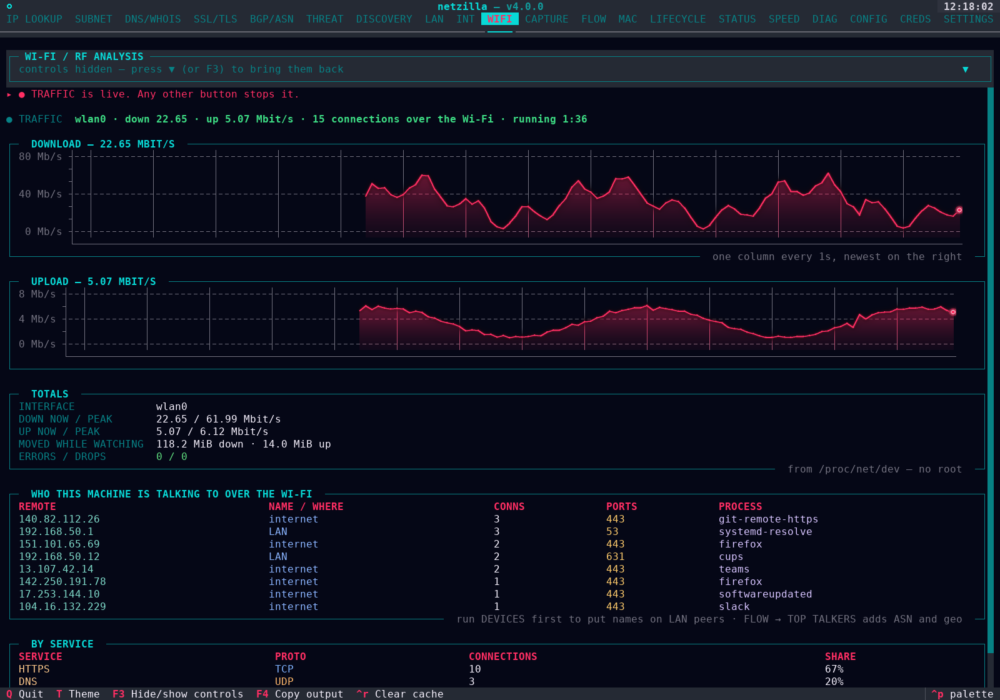 | 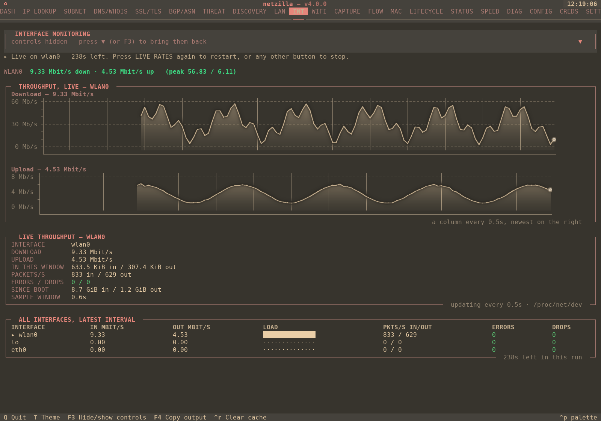 |

## New free lookups

| | |
|---|---|
| 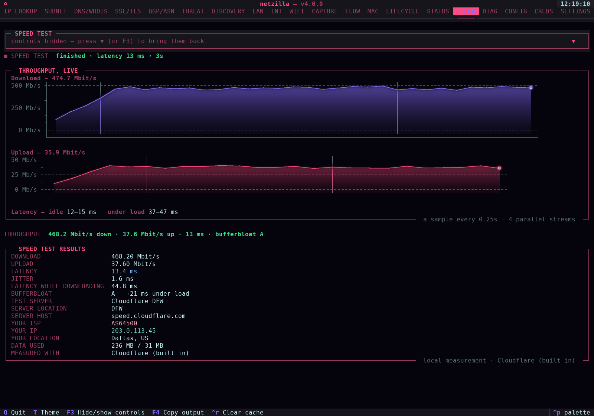 | 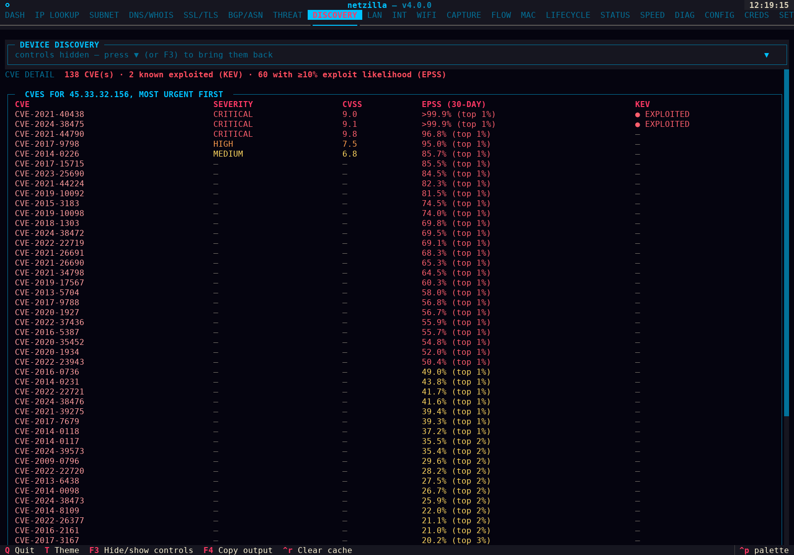 |
| 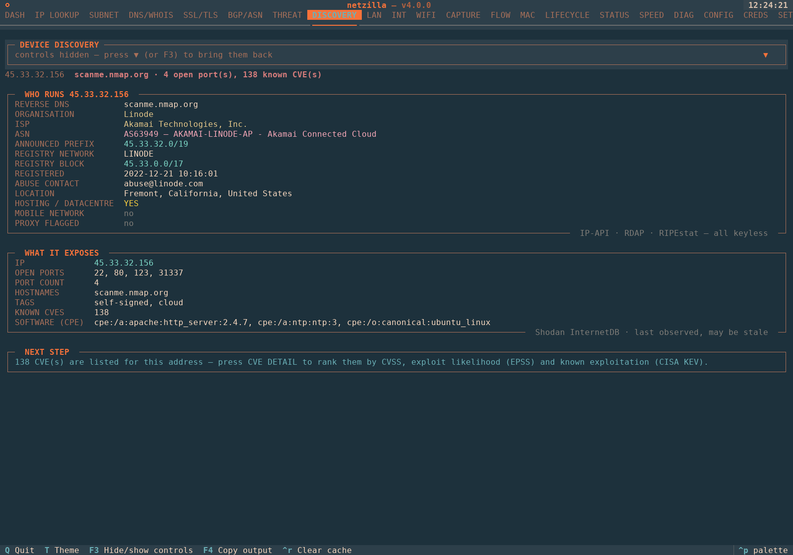 | 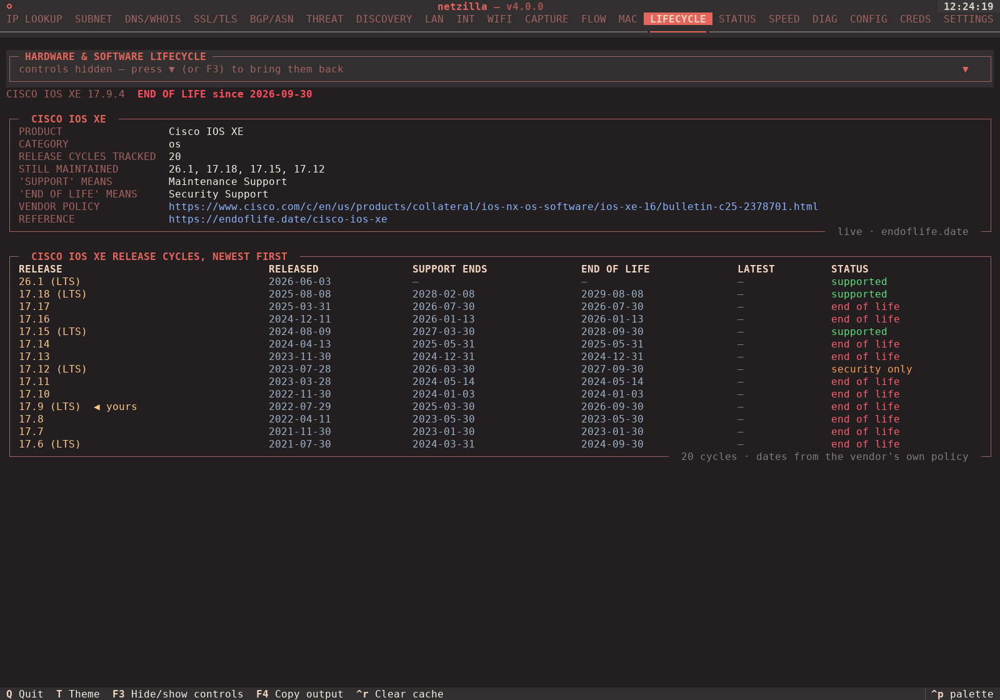 |

- **HOST PROFILE** — open ports and CVEs (Shodan InternetDB), organisation and
  location (IP-API), origin AS and prefix (RIPEstat), registry and abuse
  contact (RDAP), all at once, all free.
- **CVE DETAIL** — every CVE on an address ranked by what matters first:
  already exploited (CISA KEV), likely to be (FIRST EPSS), then severity
  (NVD CVSS).
- **SOFTWARE EOL** — `ubuntu 20.04`, `panos 10.2`, `ios-xe 17.9`,
  `fortios 7.2`: is that release still supported? Close to 500 products from
  endoflife.date. Also `netzilla software "panos 10.2"`.
- **RUN SPEED TEST** — download and upload over four streams against
  Cloudflare's free endpoints, latency, jitter and bufferbloat graded A+ to F,
  drawn live, with data use capped. Nothing to install.

More in [`docs/showcase/`](docs/showcase/) — DASH with the pixel banner, CVE
lookups with EPSS, DNS without `dig`, service status and the DISPLAY settings.
The Wi-Fi, LAN and speed-test screenshots use invented sample data; the rest
are live lookups of public hosts (scanme.nmap.org, nmap.org), across a range of
themes.

## Live views: you choose the refresh rate

Every view that streams live data has a **REFRESH EVERY (s)** box on its tab —
WIFI (LIVE AIR, SIGNAL, LINK HEALTH, TRAFFIC, PACKETS), INT (LIVE RATES), FLOW
(WATCH LIVE), CAPTURE (LIVE CAPTURE) and LAN (DUP-IP WATCH, SYSLOG CATCH).
Leave it blank for the view's default (3 s for LIVE AIR and SIGNAL, 1 s for
most others) or type any number of seconds, e.g. `1`, `0.5` or `10`.

## Colours that mean something

Values are coloured by what they are, the same way on every tab and in every
theme — in the pixel graphs too:

| What | Colour |
|---|---|
| Signal and quality (one scale) | excellent **green** · good **blue** · fair **yellow** · weak **orange** · very weak **red** |
| Band | 2.4 GHz **light blue** · 5 GHz **light green** · 6 GHz **lavender** |
| Channel | a colour of its own for every channel number (1, 6 and 11 as far apart as possible) |
| SSID | **pink** — `<hidden>` in **yellow** |
| Security | WPA3 green · WPA2 blue · WPA orange · WEP / Open red |
| Addresses | IPs **teal**, MACs **lilac**, wherever they appear |
| Names | vendors sand · hostnames periwinkle · device types orchid |
| States and verdicts | ESTAB / OK / up green · LISTEN / INFO blue · CHECK yellow · PROBLEM / down red |
| Latency, errors, scores | good-to-bad on the same five-colour scale (CVSS, EPSS, SSL grades, bufferbloat…) |

## Who's on my network?

Leave the box empty on **LAN → SWEEP** (or press **WIFI → DEVICES**) and
netzilla sweeps the subnet you're on and names every device it finds:

```
IP            MAC                VENDOR       HOSTNAME             DEVICE                DETAILS
192.168.1.1   08:9b:f1:3c:52:9f  eero         —                    Router / gateway      TTL 64 · Unix-like
192.168.1.12  04:0e:3c:8a:21:5d  HP           HP-OfficeJet-8020    Printer               HP OfficeJet Pro 8020 · IPP print
192.168.1.31  00:12:f0:6e:31:c2  Intel        DESKTOP-4K7Q2M       Windows PC            NetBIOS WORKGROUP · TTL 128
192.168.1.44  5a:e1:07:9d:40:2c  private MAC  Alexs-iPhone         iPhone                iPhone15,2 · Apple Continuity
```

*(illustrative)* The vendor comes from the full IEEE registry, bundled and
offline. The name comes from whatever the device answers: your router's DNS,
mDNS, NetBIOS or UPnP. **DEVICE** is netzilla's best guess from all of it, and
**IDENTIFY** on one IP shows the evidence behind the guess, plus which
tell-tale ports are open. No API, no key.

With a VPN up, the device probes stay on your own LAN. They are never sent
across the tunnel, and home-address lookups never go to the VPN's DNS.

## Keys

| Key | Does |
|---|---|
| <kbd>←</kbd> <kbd>→</kbd> | Switch tabs (with the tab bar focused) |
| <kbd>Tab</kbd> / <kbd>Shift</kbd>+<kbd>Tab</kbd> | Move between fields and buttons |
| <kbd>Enter</kbd> | In a box: run that box's action. On a button: press it |
| <kbd>T</kbd> | Next colour theme (<kbd>Ctrl</kbd>+<kbd>T</kbd> while typing in a box) |
| <kbd>F1</kbd> / <kbd>F2</kbd> | DASH / SETTINGS |
| <kbd>F3</kbd> | Roll this tab's controls up / down (or ▲ ▼) |
| <kbd>F4</kbd> | Copy this tab's results as text (clipboard, OSC 52 over SSH, or a file) |
| <kbd>Ctrl</kbd>+<kbd>P</kbd> | Command palette: any tab, theme, graphics mode, copy, clear cache |
| <kbd>Ctrl</kbd>+<kbd>R</kbd> | Clear the response cache |
| <kbd>↑</kbd> <kbd>↓</kbd> <kbd>Enter</kbd> <kbd>Esc</kbd> | In a live list (LIVE AIR, BLUETOOTH, BT TRACKERS): pick a row, show only it, step back — or click |
| <kbd>Q</kbd> | Quit (<kbd>Ctrl</kbd>+<kbd>Q</kbd> anywhere) |

Letters work in either case. `netzilla --tab wifi` opens on a tab (any case,
or a unique start of its name); `netzilla --help` lists the one-shot commands
(`ip`, `dns`, `asn`, `software`, `sweep`, …) for scripting, with `--json`.

## Themes

Seventeen dark retro palettes — `phosphor-green` (default), `amber-phosphor`,
`ice-cyan`, `vhs-magenta`, `ember-rust`, `sapphire-ice`, `sunset-mesa`,
`desert-sage`, `miami-night`, `arcade-pop`, `neon-mint`, `vapor-pop`,
`crt-neon`, `cyber-coral`, `route-66`, `space-1975`, `disco-70s`. Press
<kbd>T</kbd> to cycle, or pick one on SETTINGS; the pixel graphs follow the
theme. For scanlines, phosphor glow and screen curvature, run it inside
[cool-retro-term](https://github.com/Swordfish90/cool-retro-term) (text
graphs).

## Installing

Needs **Python 3.10+** and [pipx](https://pipx.pypa.io/).

```bash
# Ubuntu / Linux Mint
sudo apt update
sudo apt install -y python3 python3-venv pipx dnsutils whois openssl \
    iputils-ping traceroute mtr-tiny iw bluez
pipx ensurepath        # then open a new terminal

# macOS (dig, whois, openssl and the SNMP tools come with it)
brew install python pipx mtr
pipx ensurepath        # then open a new terminal
```

```powershell
# Windows 10 / 11, in Windows Terminal (nothing else to install)
winget install Python.Python.3.13
py -m pip install --user pipx
py -m pipx ensurepath  # then open a new terminal
```

Then, on any of them:

```bash
cd ~/Downloads
tar -xzf netzilla-4.6.0.tar.gz
cd netzilla
pipx install .
netzilla --terminal    # optional: what netzilla sees in this terminal
netzilla
```

Pillow (for the pixel graphs) is installed with it. The speed test is built
in; `pipx inject netzilla speedtest-cli` adds the optional OOKLA TEST.

Upgrading from an older version: same steps, but `pipx install --force .`.
Your theme and settings are kept.

For pixel graphs, run netzilla in [kitty](https://sw.kovidgoyal.net/kitty/)
0.28+ or [Ghostty](https://ghostty.org/) 1.0+ (the kitty packaged for Ubuntu
22.04 / Mint 21 is too old — use kitty's own installer; README.txt §3 has the
commands for both). In tmux, add `set -g allow-passthrough on` to
`~/.tmux.conf`.

`netzilla` opens straight to the DASH tab. Every tab tells you exactly which
package to install if a tool it wraps is missing — check `DIAG → TOOL CHECK`
and `WIFI → TOOL CHECK`.

Optional, for packet capture on CAPTURE and WIFI → PACKETS:

```bash
# Linux
sudo apt install -y tshark tcpdump   # answer YES to "non-superusers capture?"
sudo usermod -aG wireshark $USER     # log out & back in afterwards

# macOS: Wireshark brings ChmodBPF, so capturing needs no sudo
brew install --cask wireshark-app    # log out & back in afterwards
```

```powershell
# Windows: Wireshark, plus the Npcap driver from https://npcap.com
# (winget's install leaves Npcap out)
winget install WiresharkFoundation.Wireshark
```

On Windows, run netzilla in Windows Terminal, and on Windows 11 24H2 or later
allow desktop apps your location (Settings → Privacy & security → Location),
or Windows hides the Wi-Fi networks from WIFI → SCAN. README.txt §3 has every
step for each system and what differs on each.

## API keys

Most tabs work with nothing configured. A handful of reputation lookups
(AbuseIPDB, VirusTotal, GreyNoise, abuse.ch) need a key from a **free**
account; NVD's free key is optional and raises its rate limit. Nothing in
netzilla needs a paid plan.

> **netzilla ships with no API keys**, so any copy is safe to keep and pass along.
> Free keys: [AbuseIPDB](https://www.abuseipdb.com/account/api),
> [VirusTotal](https://www.virustotal.com/gui/my-apikey),
> [GreyNoise](https://viz.greynoise.io/signup),
> [abuse.ch](https://auth.abuse.ch/) and, optionally,
> [NVD](https://nvd.nist.gov/developers/request-an-api-key).

Type them on the **SETTINGS** tab (<kbd>F2</kbd>), SAVE, then TEST KEYS.
They are stored only in `~/.config/netzilla/config.toml` (mode 0600), or
`%APPDATA%\netzilla\config.toml` on Windows.

## Data sources

All free: IP-API, AbuseIPDB, VirusTotal (public API), GreyNoise Community,
IPLogs, RDAP, Cloudflare/Google/Quad9 DNS-over-HTTPS, Qualys SSL Labs, crt.sh,
RIPEstat, Team Cymru, NVD, CISA KEV, FIRST EPSS, abuse.ch (URLhaus,
ThreatFox, MalwareBazaar, Feodo Tracker), Shodan InternetDB, macvendors.com,
EOSL.ai, endoflife.date, OutageDeck, Cloudflare's speed-test endpoints and
Have I Been Pwned — plus the local tools. README.txt §6 lists each one's
limits. Responses are cached in SQLite so repeat lookups cost no quota.

## Running the tests

```bash
pip install -e ".[dev]"
pytest -q
```

927 tests. Everything is exercised with recorded or mocked responses and a
fake terminal; macOS and Windows are faked with their tools' recorded output
and the Windows API structures built byte by byte. No network calls, no root,
no packets sent to the devices on your LAN, and no real key is ever used or
printed.

## Scope, on purpose

netzilla diagnoses *networks*, not people. There's no username-enumeration,
email/phone-lookup or credential-harvesting tooling in here — profiling a
person is a different job than diagnosing a network. The one exception is
CREDS, which only checks *your own* password or address against Have I Been
Pwned. Nothing on the WIFI tab associates with, deauthenticates or attacks
anyone's network; DEVICES, PORTS and PACKETS are for networks you run.

## License

MIT. netzilla is an independent project and isn't affiliated with, endorsed
by, or sponsored by any of the data providers it queries. Only scan or
enumerate infrastructure you own or are explicitly authorized to test.
